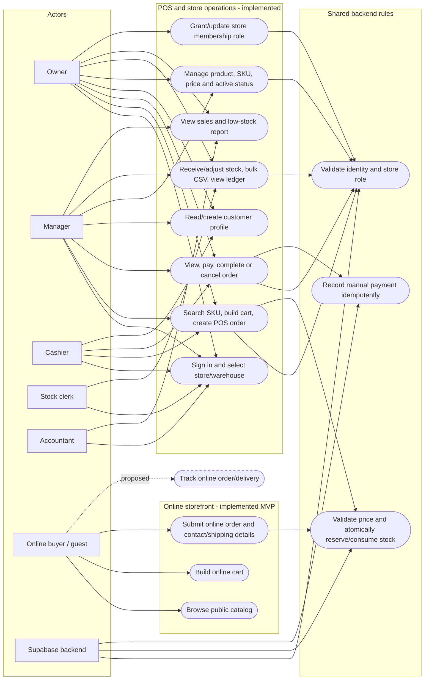

## Phạm vi và nguồn

Đối chiếu code hiện tại với `README` và `SRS`. SRS ghi rõ trạng thái draft/chưa phê duyệt. Nội dung dưới đây phân biệt các luồng **đã triển khai** với các đề xuất **chưa triển khai**.

## 1. Actors

| Actor | Mục tiêu | Quyền/thực tế |
|---|---|---|
| **Owner (chủ cửa hàng)** | Vận hành cửa hàng, cấp quyền nhân viên | Có các quyền của manager/cashier và stock; xem báo cáo; quản lý membership/vai trò của cửa hàng mình. Owner đầu tiên được khởi tạo ngoài giao diện bằng script vận hành. Đây là owner theo cửa hàng, không đồng nghĩa super-admin toàn hệ thống. |
| **Manager (quản lý)** | Điều hành bán hàng, danh mục và tồn | POS/đơn; quản lý sản phẩm/SKU; nhập/điều chỉnh tồn; khách hàng; báo cáo. Không quản lý membership. |
| **Cashier (thu ngân)** | Bán hàng tại quầy và thu tiền | POS, xem đơn, ghi nhận payment, hoàn tất/hủy đơn, xem/tạo/cập nhật khách hàng. Không quản lý danh mục hoặc kho. |
| **Stock clerk (nhân viên kho)** | Theo dõi và cập nhật tồn | Xem dữ liệu sản phẩm/tồn được cấp; ghi nhập/điều chỉnh, nhập lô CSV; đọc ledger. Không có POS/đơn trong UI. |
| **Accountant (kế toán)** | Đối soát doanh số và thanh toán | UI có báo cáo; RLS cho phép đọc đơn, payment, khách hàng, ledger. Edge Function cũng cho phép role này gọi `record_payment`, nhưng UI không hiện màn hình đơn cho accountant. |
| **Khách mua online/guest** | Duyệt sản phẩm và đặt hàng | Có thể xem catalog, tạo giỏ và đặt đơn không cần tài khoản tại `/shop`; checkout yêu cầu tên, số điện thoại và địa chỉ giao hàng. Không có buyer auth hoặc tra cứu đơn online. |
| **Supabase/backend (actor hệ thống)** | Xác minh quyền và bảo toàn giao dịch | Edge Functions, RLS và PostgreSQL RPC xác thực/kiểm tra dữ liệu, giá, idempotency, giữ tồn, payment và ledger. Đây là actor kỹ thuật trong đặc tả, không phải người dùng được cấp role. |

Trong code, các role và menu được kết hợp tại `App.tsx`, menu hiển thị trong `Sidebar.tsx`, còn kiểm tra action server ở `manage-operations/index.ts`. “Admin” chung trong SRS chỉ gần với owner về một số tác vụ; không nên xem là cùng một role hệ thống.

## 2. Use case model

`[HIỆN CÓ]` là luồng có code; `[SRS DRAFT]` là use case mô tả trong đặc tả nhưng chưa có trong app.

Storefront MVP tại `/shop` đọc catalog qua Edge Function, gửi checkout đến backend dùng chung, lưu thông tin khách/địa chỉ và tạo đơn có idempotency; giá và giữ tồn vẫn do RPC hiện hữu xử lý. Buyer auth, theo dõi đơn, điều phối giao hàng và payment gateway/webhook chưa triển khai. SRS cũng có return/refund nhưng README xác nhận chưa triển khai đổi trả/hoàn tiền.

## 3. Chức năng theo module và quyền

| Module | Chức năng thực tế / use case | Quyền thực tế | Trạng thái |
|---|---|---|---|
| Auth & cửa hàng | Đăng nhập email/mật khẩu, khôi phục phiên, chọn cửa hàng/kho, role-gate menu | Thành viên đã cấp membership; owner khởi tạo đầu tiên qua script | Đã có; không thấy signup buyer |
| POS/tạo đơn | Tìm tên/SKU/biến thể, giỏ, khách tùy chọn, nhận một phần tiền, tạo đơn | Owner/manager/cashier | Đã có; gọi Edge Function `create-order`, server/RPC lấy giá DB và giữ tồn có transaction/idempotency |
| Quản lý đơn | Danh sách tối đa 250 đơn, ghi nhiều khoản thu tiền mặt/chuyển khoản thủ công, hoàn tất (xuất tồn), hủy (nhả tồn giữ) | UI owner/manager/cashier; Edge Function kiểm tra role tương ứng | Đã có; trạng thái code gồm confirmed/fulfilled/cancelled, không có vòng đời giao hàng online |
| Catalog & SKU | Tạo product+SKU, thêm variant, cập nhật giá, bật/tắt bán, tải ảnh sản phẩm và hiển thị thumbnail | Owner/manager ghi và tải ảnh; store roles đọc theo RLS; thumbnail công khai từ bucket ảnh riêng | Đã có. Lưu ý product/variant hiện không có `store_id`; policy catalog dựa trên role ở bất kỳ store nào, nên đây chưa phải catalog cô lập theo cửa hàng |
| Kho | Nhập/điều chỉnh có lý do; batch tối đa 200 dòng/CSV; xem tồn khả dụng/đang giữ, ledger bất biến, cảnh báo ngưỡng thấp | Owner/manager/stock clerk ghi; quyền đọc ledger phụ thuộc role (owner/manager/stock clerk/accountant) | Đã có; qua `manage-operations` + RPC. Kiểm kê theo đợt, chuyển kho, xuất/giao hàng cho shipping không có UI hiện tại |
| Khách hàng | Xem hồ sơ/lịch sử đơn, tạo hồ sơ tên và điện thoại | UI customer screen cho owner/manager/cashier; accountant có đọc qua RLS nhưng không có screen | Đã có một phần; RLS cho phép sales staff update, nhưng UI hiện thấy chỉ tạo và đọc, không có luồng sửa/xóa đầy đủ |
| Báo cáo | Doanh số, số đơn, đã thu/còn phải thu, tồn thấp theo khoảng ngày | Owner/manager/accountant | Đã có báo cáo tổng quan; không thấy xuất báo cáo hay báo cáo kế toán tổng hợp |
| Phân quyền | Tạo/cập nhật membership và role cửa hàng | Chỉ owner; bảo vệ owner cuối cùng ở RPC | Đã có; quản trị tài khoản/Auth tổng thể và audit log theo yêu cầu SRS chưa thấy trong app |
| Website online | Catalog, tìm kiếm, cart, checkout guest, địa chỉ nhận hàng và đặt đơn | Khách guest; catalog/checkout được phục vụ qua Edge Function công khai, không cấp quyền đọc bảng trực tiếp | MVP đã triển khai tại `/shop`; dùng cùng store, catalog, giá, đơn hàng và RPC giữ tồn như POS. Tra cứu/trạng thái giao hàng và thanh toán online chưa có |
| Payment/returns | Ghi nhận khoản thu thủ công có idempotency | Owner/manager/cashier UI; backend còn cho accountant `record_payment` | Thu thủ công đã có; cổng thanh toán, webhook, hoàn tiền/trả hàng chưa có |

### Các điểm cần hiểu đúng về quyền

- Ẩn màn hình trong React chỉ điều khiển UX; quyền thật nằm ở RLS/Edge Function/RPC trong migration `20261023010000_complete_single_store_mvp.sql` và các migration tiếp theo.
- RLS hiện tách dữ liệu giao dịch theo membership/store cho nhiều bảng, nhưng product/variant là global theo schema hiện tại. Trước khi online hoặc nhiều cửa hàng độc lập, cần quyết định catalog chung hay từng store; không thể cấp anonymous read an toàn chỉ bằng cách dựng UI.
- Accountant là ví dụ khác biệt UI/backend: role được phép ghi payment trong Edge Function nhưng menu đơn không hiện cho role này. Nếu đó là chủ đích, nên giữ rõ trong ma trận; nếu không, cần đồng bộ UI và quyền.
- So với ma trận vai trò đề xuất ở SRS, code hiện cho manager/cashier hủy đơn trực tiếp qua xác nhận trình duyệt; chưa thấy ngưỡng phê duyệt, phân tách nhiệm vụ hay audit log như một số yêu cầu draft.

Kết quả là: mô hình **POS và quản trị dùng chung backend đã hoạt động**, còn **website online là phạm vi đề xuất**. Chức năng online cần thiết kế/duyệt quyền truy cập, guest/account, giá/catalog theo store, thời điểm giữ tồn, fulfillment/giao hàng và payment trước khi thêm schema hoặc policy mới.